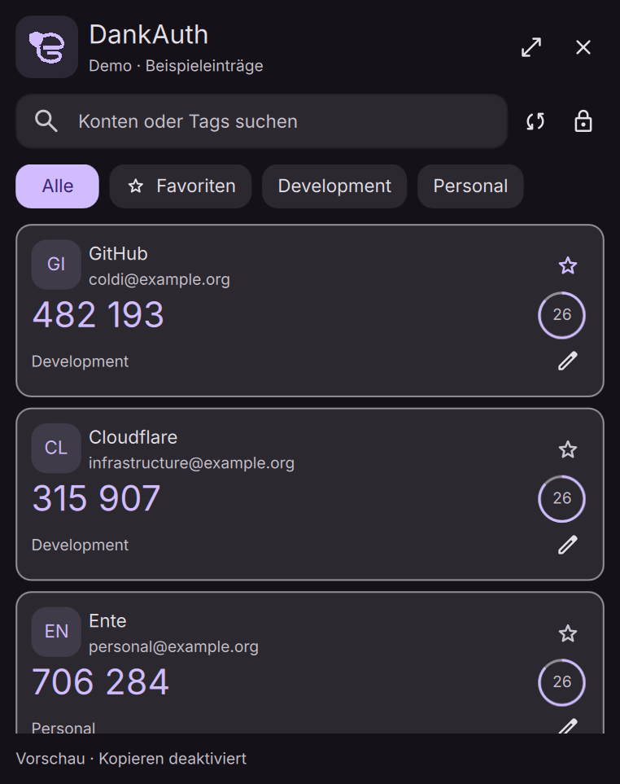

# DankAuth

**Ente Auth für DankMaterialShell.** Ein nativer, inoffizieller Authenticator mit verschlüsselter Synchronisierung, Suche, Pins, Tags und einem separaten Fenster. Farben, Schrift, Abstände und das Logo folgen deinem DMS-Theme.

[English](README.md) · [Änderungen](CHANGELOG.md) · [Lizenz](LICENSE)



## Installation

Voraussetzungen: **DMS ab 1.6.2**, **Node.js ab 20** und eine Wayland-Sitzung. Der Dienst samt Abhängigkeiten wird bereits gebündelt mitgeliefert. **npm und wl-clipboard sind für den Betrieb nicht erforderlich.**

```sh
git clone https://github.com/coldi1337/DankAuth.git ~/.config/DankMaterialShell/plugins/DankAuth
dms ipc call plugin-scan scan
dms ipc call plugins enable enteAuth
dms ipc call enteAuth addToBar default
```

Alternativ unter DMS Einstellungen → Plugins scannen und **DankAuth** aktivieren, danach das Widget zur Leiste hinzufügen. Der Startcheck erklärt fehlendes Node.js oder beschädigte Dienstdateien. `addToBar` fügt das Symbol hinter Bitwarden ein. Die Plugin-ID bleibt aus Kompatibilitätsgründen `enteAuth`.

`scripts/install-local` installiert den Entwicklungsordner als Symlink und ersetzt keine fremde Installation. Bei einem bestehenden `EnteAuth`-Symlink diesen weiterverwenden und seinen Quellordner aktualisieren; keine zweite Kopie mit derselben Plugin-ID aktivieren.

## Bedienung

- **Linksklick:** Popout öffnen oder schließen. **Rechtsklick:** separates Fenster öffnen, wie bei DankChat.
- Die Suche erhält automatisch den Fokus. Suche nach Anbieter, Konto oder Tag; Filter für Tags und Favoriten.
- Pfeiltasten wählen Karten aus. **Enter** kopiert die ausgewählte Karte oder den ersten Treffer. Ein Klick auf den Code kopiert ebenfalls.
- **Strg+F:** Suche fokussieren. **Strg+L:** sperren. **Escape:** Tag-Editor verlassen oder Ansicht schließen.
- Der Stern setzt oder entfernt einen Ente-Pin. Der Stift bearbeitet durch Kommas getrennte Tags. Beide Änderungen werden verschlüsselt an Ente zurückgeschrieben.
- Ein Häkchen bestätigt das Kopieren. Die Einstellung **Popout nach dem Kopieren schließen** lässt das separate Fenster geöffnet.

Der Countdown läuft lokal. Zwischen Listenaktualisierungen werden nur abgelaufene Codes übertragen. Auswahl und Scrollposition bleiben erhalten. Die Popout-Höhe folgt der Trefferzahl und dem Bildschirm; breite Fenster zeigen zwei Spalten.

Die Oberfläche folgt der DMS-Sprache: **Englisch** ist die Quellsprache, **Deutsch** liegt vollständig in `translations/de.json`. Direkte `I18n.trFor("enteAuth", "English term")`-Aufrufe unterstützen die zentrale Textextraktion. DMS erwartet keine `en.json`; andere Sprachen verwenden englische Texte oder vorhandene globale DMS-Übersetzungen.

## Anmeldung und Synchronisierung

Unterstützt werden Passwort/SRP, E-Mail-Bestätigung, TOTP als zweiter Faktor und Passkey-Verifikation im Browser. Ein Passkey ersetzt nicht das Passwort zur Entschlüsselung. API- und Accounts-Adresse für selbst gehostete Instanzen sind einstellbar. Eine geänderte API-Adresse gilt bei einer neuen Anmeldung; gespeicherte Konten behalten ihren Server.

Die erste Anmeldung synchronisiert die Codes. Ein gespeichertes Konto lässt sich offline entsperren; danach folgt ein Sync-Versuch. Der Status unterscheidet aktuell, offline/gespeichert und Fehler. Hintergrund-Sync erfolgt standardmäßig alle fünf Minuten und verlängert die Inaktivitätsfrist nicht. Die DMS-Bildschirmsperre sperrt auch den Tresor. Nach einem Plugin-Neuladen erneut entsperren.

Vor dem Speichern von Pins oder Tags wird die aktuelle Remote-URI gelesen, um Notizen und unbekannte Parameter zu erhalten. Gleichzeitige Bearbeitungen mehrerer Geräte können dennoch kollidieren, da dieser API-Ablauf keinen atomaren Versionsvergleich anbietet. TOTP und Steam werden unterstützt. HOTP bleibt schreibgeschützt und verweist auf Ente; Zähler werden nicht erhöht. Kein Bearbeiten von Secrets, Löschen, QR-Import oder Browser-Autofill.

## Zwischenablage und Speicherung

Kopieren verwendet **die native DMS-Zwischenablage**. Text-MIME-Angebote und `x-kde-passwordManagerHint=secret` werden gemeinsam über DMS' bestehenden Multi-Offer-Transport per Standardeingabe übergeben. Codes stehen nie in Befehlsargumenten. Mehrfaches Einfügen funktioniert bis zum Codeablauf oder Sperren. Dann beendet DankAuth seine eigene Clipboard-Quelle; danach von anderen Anwendungen kopierte Inhalte bleiben erhalten. Clipboard-Manager müssen den Sensitive-Hinweis selbst beachten.

Der Multi-Offer-Transport steht im [DMS-Quellcode](https://github.com/AvengeMedia/DankMaterialShell/blob/master/core/cmd/dms/commands_clipboard.go), ist intern und auf DMS 1.6.2 geprüft. Auf Versionen ohne Bereitschaftsbestätigung prüft DankAuth die Auswahl über den nativen Paste-Befehl. Bei einem Fehler wird keine erfolgreiche Kopie angezeigt.

Die QML-Oberfläche erhält keine OTP-Secrets oder Master-Schlüssel. `$XDG_STATE_HOME/dms-ente-auth/vault.json` (standardmäßig `~/.local/state/dms-ente-auth/vault.json`) hat Rechte `0600`. Token und Code-Cache sind verschlüsselt; das Passwort wird nicht gespeichert. E-Mail-Adresse, Server und verschlüsselte Schlüsselattribute bleiben als Kontometadaten erhalten. Abmelden entfernt die Datei. Demo-Modus beendet den echten Dienst und deaktiviert Kopieren und Bearbeiten.

## Entwicklung und Prüfung

```sh
npm ci --no-audit --no-fund
npm run build
npm run validate
npm test
./scripts/test-ui
./scripts/test-clipboard
```

Der Build erstellt `backend/dist/main.js` und Lizenzhinweise in `backend/licenses/`. GitHub Actions prüft Node 20/22, Übersetzungen, Metadaten, Backend, reproduzierbaren Build und den Dienst ohne node_modules. Der UI-Test benötigt DMS-Komponenten und Wayland. Er verwendet eine private Sitzung mit Beispieldaten und prüft Deutsch/Englisch, Tastatur, stabile Karten, adaptive Höhe, Links-/Rechtsklick, sieben Anmeldeschritte sowie Dunkel-/Hell-/Custom-Theme bei 360/476/800 Pixeln.

Der optionale Clipboard-Test nutzt wl-clipboard ausschließlich als unabhängige Prüfhilfe. Vorheriger Text bleibt nur im Speicher; andere Datenformate werden übersprungen und zwischenzeitlich fremd kopierte Inhalte nicht überschrieben. Der Produktbetrieb benötigt kein wl-clipboard.

Lokal geprüft auf **Arch Linux, Hyprland, DMS 1.6.2**. Weitere Compositors oder Distributionen werden im vorbereiteten Registry-Eintrag noch nicht zugesichert. Das echte Konto wurde interaktiv geprüft; automatisierte Anmelde- und Schreibtests verwenden ausschließlich synthetische Daten.

## Registry, Herkunft und Lizenz

`registry/coldi1337-dankauth.json` bereitet eine spätere Registry-Einreichung vor. Es gibt noch keine Einreichung oder Freigabe. Die Aufnahme in POEditor ist ein eigener Schritt; `i18n: true` wird bewusst nicht gesetzt. Eine spätere Registry-PR muss die wesentliche KI-Unterstützung offenlegen und menschlich geprüft werden.

**AGPL-3.0-only.** Protokoll-, Kryptografie- und OTP-Helfer stammen aus [aheimowitz/ente-auth-extension](https://github.com/aheimowitz/ente-auth-extension), Revision `78e7ff8668c60b2fc31268293698de0e7014349c`. Siehe [THIRD_PARTY_NOTICES.md](THIRD_PARTY_NOTICES.md) und [gebündelte Lizenzhinweise](backend/licenses/NOTICE.txt).

Das eigene vereinfachte Vektorsymbol orientiert sich am runden e und kleinen Schild von [Ente Auth](https://ente.com/auth/). Original-SVG-Pfade und Logo-Bilddateien werden nicht mitgeliefert. DankAuth ist kein offizielles Ente- oder DMS-Produkt. Wesentliche Implementierung und Dokumentation entstanden mit KI-Unterstützung und wurden durch die enthaltenen Prüfungen verifiziert.
