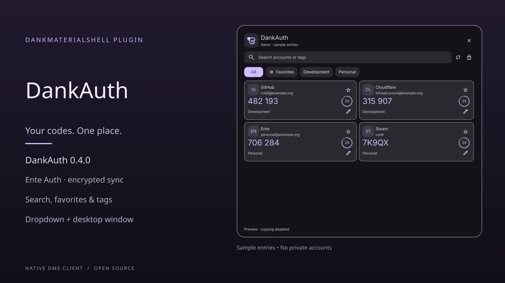

# DankAuth

**Ente Auth for DankMaterialShell.** A native, unofficial authenticator panel with encrypted sync, account search, pins, tags and a separate desktop window. Colors, typography, spacing and the logo follow your DMS theme.

[Deutsch](README.de.md) · [Changelog](CHANGELOG.md) · [License](LICENSE)



## Install

Requirements: **DMS 1.6.2 or newer**, **Node.js 20 or newer**, and a Wayland session. The released backend and its dependencies are bundled in the repository; **npm and wl-clipboard are not required to run it**.

```sh
git clone https://github.com/coldi1337/DankAuth.git ~/.config/DankMaterialShell/plugins/DankAuth
dms ipc call plugin-scan scan
dms ipc call plugins enable enteAuth
dms ipc call enteAuth addToBar default
```

Alternatively scan and enable **DankAuth** in DMS Settings → Plugins, then add it to your bar. A startup check explains missing Node or damaged backend files. `addToBar` inserts the widget after Bitwarden without replacing other widgets. The plugin ID remains `enteAuth` for compatibility with existing installations.

The `scripts/install-local` helper supports developers using a symlink. It refuses to replace an unrelated installation. Already installed through an `EnteAuth` symlink? Keep that installation and update its source; do not enable a second copy with the same plugin ID.

## Use

- **Left click:** toggle the popout. **Right click:** open the separate window, like DankChat.
- Search receives focus when opened. Search by issuer, account or tag; filter by tags or favorites.
- Arrow keys select a card; **Enter** copies the selected card or first match. Clicking a code copies it too.
- **Ctrl+F** focuses search, **Ctrl+L** locks, **Escape** dismisses the tag editor or closes the view.
- The star writes an Ente pin; the pencil edits comma-separated tags. Both sync back to Ente, encrypted.
- A checkmark confirms copying. The optional **Close popout after copying** setting leaves the separate window open.

The countdown runs locally. Only expired codes are updated between list refreshes, preserving selection and scroll position. The popout adapts to result count and screen height; wide windows use two columns.

The UI follows the DMS locale: **English** is the source language, **German** is included in `translations/de.json`. Every translatable UI term uses a literal `I18n.trFor("enteAuth", "English term")` call, ready for central extraction. DMS expects no `en.json`; other locales fall back to English or DMS's global translations.

## Sign-in and sync

Supports Ente password/SRP login, email verification, TOTP as a second factor and browser passkey verification. A passkey does not replace the password required to decrypt your vault. Self-hosted API and Accounts endpoints are configurable. Changing the API endpoint applies to a new sign-in; an existing vault retains its server.

First sign-in syncs your codes. A saved account unlocks offline, then attempts a fresh sync. The footer distinguishes up-to-date, cached/offline and sync errors. Background sync defaults to five minutes. Background activity does not extend the inactivity timeout; the vault also locks with the DMS screen lock. Reloading the plugin requires unlocking again.

Pins and tags fetch the latest remote URI before writing, preserving notes and unknown parameters. Ente's entity API has no atomic version comparison in this flow; simultaneous edits on multiple devices can still conflict. TOTP and Steam codes are supported. HOTP stays read-only and points you to Ente; its counter is never advanced. Secret editing, deletion, QR import and browser autofill are outside this release.

## Clipboard and storage

Copying uses **DMS's native clipboard**, not wl-copy. The bridge sends text MIME offers and `x-kde-passwordManagerHint=secret` through DMS's existing multi-offer stdin transport. OTPs never appear in command arguments. Repeated pasting works until expiry or locking, when DankAuth terminates its own clipboard source. Data subsequently copied by another application is not cleared. Clipboard managers must honor the sensitive hint themselves.

The multi-offer protocol is implemented in [DMS's clipboard command](https://github.com/AvengeMedia/DankMaterialShell/blob/master/core/cmd/dms/commands_clipboard.go). It is an internal transport, tested on DMS 1.6.2. DankAuth verifies selection readiness using the native paste command on versions without a ready-byte handshake. It fails explicitly if copying is unavailable.

The local bridge keeps OTP secrets and master keys out of QML. `$XDG_STATE_HOME/dms-ente-auth/vault.json` (default `~/.local/state/dms-ente-auth/vault.json`) has permissions `0600`; token and code cache are encrypted. Passwords are not saved. Account email, server and encrypted key attributes remain as vault metadata. Sign out removes that file. Demo mode disconnects the real bridge and disables copying and edits.

## Development and verification

```sh
npm ci --no-audit --no-fund
npm run build
npm run validate
npm test
./scripts/test-ui
./scripts/test-clipboard
```

Build changes only `backend/dist/main.js` and bundled dependency notices in `backend/licenses/`. GitHub Actions verifies Node 20/22, translations, metadata, backend tests, reproducible build and standalone runtime. The UI test needs the installed DMS components and a running Wayland session. It uses a private session and sample data, checks German/English switches, keyboard navigation, stable code cards, adaptive height, left/right clicks, seven sign-in states and dark/light/custom themes at 360/476/800 pixels.

The optional clipboard integration test uses wl-clipboard **only as an independent test probe**. It preserves previous text in memory, skips non-text selections and avoids overwriting clipboard content copied elsewhere during testing. Runtime copying itself requires only DMS.

Verified locally on **Arch Linux, Hyprland, DMS 1.6.2**. Other compositors and distributions are not yet claimed in the prepared registry metadata. The user's real account has been verified interactively; automated auth and metadata-write tests use synthetic fixtures and do not modify that account.

## Registry and provenance

`registry/coldi1337-dankauth.json` is submitted in [registry PR #1032](https://github.com/AvengeMedia/dms-plugin-registry/pull/1032), pending maintainer review and merge. Central POEditor enrollment is separate; the entry intentionally does not set `i18n: true`. Registry submissions disclose AI assistance and remain subject to maintainer review.

DankAuth is **AGPL-3.0-only**. Ente protocol, crypto and OTP helpers derive from [aheimowitz/ente-auth-extension](https://github.com/aheimowitz/ente-auth-extension), revision `78e7ff8668c60b2fc31268293698de0e7014349c`. See [THIRD_PARTY_NOTICES.md](THIRD_PARTY_NOTICES.md) and [bundled dependency notices](backend/licenses/NOTICE.txt).

The original simplified logo drawing is inspired by the rounded e and small shield of [Ente Auth](https://ente.com/auth/). No original SVG paths or logo bitmaps are bundled. DankAuth is not affiliated with or endorsed by Ente or DankMaterialShell. Developed with AI assistance for implementation, tests and documentation. Verification is described above.
